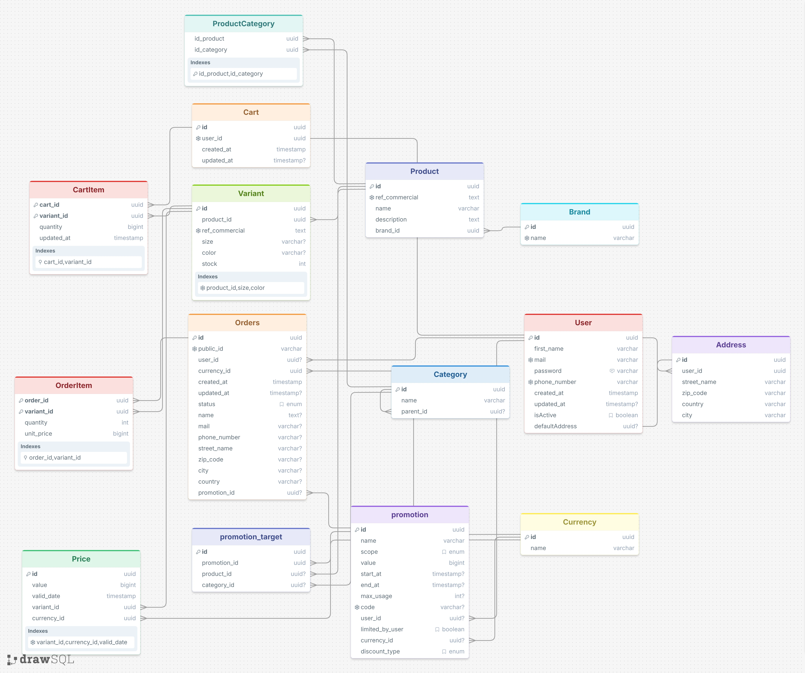

# BigData

Schéma relationnel d'une boutique en ligne (vêtements, chaussures, accessoires), un générateur de données de test et des requêtes SQL d'analyse (« défis »). Hébergé sur Supabase (PostgreSQL).



## Contenu

| Fichier | Rôle |
|---|---|
| `schema.sql` | Création des 15 tables (`User`, `Address`, `Product`, `Category`, `ProductCategory`, `Brand`, `Variant`, `Price`, `Currency`, `Cart`, `CartItem`, `Orders`, `OrderItem`, `promotion`, `promotion_target`) |
| `db.js` | Outil CLI : `migrate` et `test` |
| `seed.js` | Génère des données fictives (50 users, 30 produits, 1200 commandes, 10 promos), reproductibles via `SEED` |
| `defi.sql` | Requêtes d'analyse (CA par pays, panier moyen par ville, meilleurs clients…) |
| `schemaBigData.webp` | Diagramme du schéma |

## Prérequis

- Node.js 20.6+ (option `--env-file`)
- Une base PostgreSQL (ex. projet Supabase)

## Installation

```bash
npm install
cp .env.example .env   
```

`DATABASE_URL` : Supabase > Project Settings > Database > Connection string (URI).

## Utilisation

```bash
npm run migrate   
npm run seed      
npm test          
```

Seed reproductible : `SEED=7 npm run seed` (défaut : 42).

Les requêtes de `defi.sql` se lancent dans le SQL Editor de Supabase ou via `psql`.

## Notes

- Les montants sont stockés en centimes (`/ 100.0` dans les requêtes).
